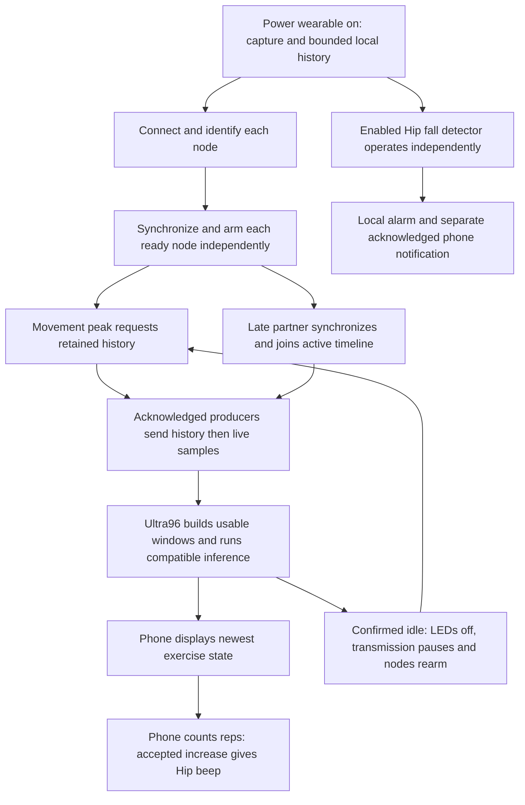

# Communications design evolution

Consolidated on 16 November 2026 from the nine planning, presentation and progress
notes listed in [Source consolidation](#source-consolidation). This is a record
of the communications subsystem's evolution for the design report. Historical
proposals and completed demonstrations are distinguished from the final source
configuration. It does not establish that every final feature was physically
validated.

Use [Experiments and results](EXPERIMENTS_AND_RESULTS.md) for dated evidence and
remaining measurements, and [Communications design choices](COMMUNICATIONS_DESIGN_CHOICES.md)
for detailed final tradeoffs. Build and deployment commands belong in the
[component guides](README.md#component-guides).

## 1. Milestones and original assessment scope

Phases 1-10 were completed in preparation for the Individual Subsystem Test
on 1 October.

The individual communications assessment was deliberately narrower than the
complete exercise product. Two physical FireBeetles, then called Hub 3 and Hub 6,
generated mock IMU data. A laptop keystroke selected a complete binary IMU
request, the selected FireBeetle transformed it, Ultra96 validated the correlated
response and produced one random simulated exercise event, and the phone
displayed that event. Random labels demonstrated communication, not AI accuracy.

| Milestone | Purpose | Retained evidence |
| --- | --- | --- |
| 1. Protocol codecs | Freeze binary layouts and independently check byte order and invalid input. | [Phases 1-6](handoffs/PHASE_1_TO_6_PHYSICAL_TEST_RESULTS_AND_HANDOFF.md) |
| 2. Application/transport separation | Give one task ownership of the connection and exchange work through bounded queues. | Phases 1-6 |
| 3. Interactive requests | Correlate requests/responses; return cached duplicates and reject conflicting sequence reuse. | Phases 1-6 |
| 4. Verified TLS | Authenticate the laptop relay and encrypt the wearable-facing hop. | Phases 1-6 |
| 5. Sustained stream | Demonstrate at least one minute of approximately 50 Hz mock data and readable rate/integrity statistics. | Phases 1-6 |
| 6. Throughput benchmark | Measure bounded maximum-speed application traffic and return to normal streaming. | Phases 1-6 |
| 7. File transfer | Validate chunks and reconstruct a file with matching SHA-256 without storing the whole file on the ESP32. | [Phase 7](handoffs/PHASE_7_PHYSICAL_TEST_RESULTS_AND_HANDOFF.md) |
| 8. Concurrent producers | Demonstrate two independent connections, targeted operations and throughput. | [Phase 8](handoffs/PHASE_8_PHYSICAL_TEST_RESULTS_AND_HANDOFF.md) |
| 9. Recovery | Isolate resets/network loss and prevent stale operations crossing sessions. | [Phase 9](handoffs/PHASE_9_PHYSICAL_TEST_RESULTS_AND_HANDOFF.md) |
| 10. Phone display | Produce one simulated exercise update per new valid response and correlate it with the physical display. | [Phase 10](handoffs/PHASE_10_IMPLEMENTATION_HANDOFF.md) |

Clock coordination, real MPU6050 acquisition, real inference, the proposed
six-node topology, automatic wearable hub failover and a complete AR game were
outside that assessment milestone. Later work added synchronization, physical
capture, dynamic membership and feedback separately. A basic Unity status panel
satisfied the recorded communications visualizer requirement; AR objects,
form correction, a second-phone WebRTC stream, accounts and persistent analytics
were deferred rather than prerequisites for that demonstration.

## 2. Network route and producer topology

**Original approach and issue.** Earlier work explored ESP32 traffic over campus
Wi-Fi, direct application-port access to Ultra96, and embedded SSH. Association
with campus Wi-Fi succeeded, but the required direct TCP paths did not. A simple
jump-host application-port forward was rejected; the working SSH route required
reaching Ultra96's SSH service through the jump host. These observations identify
an unusable tested route without proving the exact campus firewall mechanism.

**Selected change.** A private DIR-842 LAN carries wearable and phone traffic to
the laptop. The laptop keeps its campus/VPN route and forwards traffic through
SSH. Its private adapter has no default gateway or DNS. Moving routing to the
laptop avoided implementing nested SSH on the ESP32. The router, laptop, relay,
VPN and tunnel remain deployment dependencies and shared failure points.

The original hub/leaf and ESP-NOW work was superseded by independent Node 1
(Thigh/Hip) and Node 2 (Wrist) producers. Each owns its sensor stream, TLS
connection, transport session and clock mapping. The final communications
firmware does not forward IMU samples between wearables. Historical Hub 3/6
identifiers must not be used as current node configuration.

Evidence: [NUS network experiments](results/NUS_NETWORK_TEST_RESULTS.md) and
[concurrent-producer tests](EXPERIMENTS_AND_RESULTS.md#4-concurrent-producers-and-recovery).

## 3. Transport, framing and security boundaries

**Original approach.** The assessment reused the existing version-1 binary
protocol instead of inventing separate keystroke or benchmark formats. Its
24-byte header carries framing, identity, payload length, session, sequence and
timestamp. Explicit network byte order avoids dependence on compiler structure
layout. TCP requires buffering partial headers/payloads and handling several
frames in one read; ordered transport does not supply message boundaries.

**Change and reason.** Socket ownership moved to one transport task. Bounded
application-command, response and sensor queues isolate processing from TLS
I/O. Session loss clears stale request, benchmark and file-transfer state.
Duplicate identity checks and acknowledgements add application semantics that
TCP delivery alone cannot establish. Reconnect uses bounded backoff.

Wearable TLS terminates at the interactive laptop relay because that relay
must inspect requests, measurements and diagnostic traffic. SSH protects the
onward laptop-to-Ultra96 leg. Phone TLS terminates at the Ultra96 WSS gateway;
the separate transparent laptop relay copies ciphertext. Internal publisher
and control services bind to Ultra96 loopback. These are different TLS
boundaries, not one uninterrupted wearable-to-Ultra96 TLS connection.

**Issues solved.** Benchmark and history arrays placed on task stacks caused
stack overflow or corrupted task memory. Fixed, single-owner static buffers
kept storage bounded without putting large arrays on the TLS/acquisition stacks.
Benchmark counters were reset for every run, and heartbeats were suppressed
during benchmark mode to avoid contaminating the measurement. File-transfer
cleanup was repaired after failed transfers, and file sending moved to a
background task so keyboard handling remained responsive.

CRC32 checks accidental per-chunk corruption; streaming SHA-256 checks complete
file identity. Neither replaces TLS authentication. The historical shared
development token was not a unique production credential. Detailed outcomes
and limitations remain in the phase handoffs and results record.

## 4. Continuous transmission versus triggered history

The 15 October proposal separated acquisition rate, transmission cadence and AI
hop size. It initially preferred continuous transmission after a scheduled
common START. A hardware-gated alternative retained samples locally until an
activity trigger. Both approaches placed overlapping windows on Ultra96 so a
sample need not be transmitted again merely because it occurs in several
inference windows.

For example, a proposed five-second window at 100 Hz contains 500 samples per
node. With a one-second hop, the next window can reuse 400 samples and receive
100 new ones. This is a design calculation, not a throughput measurement.

The 20 October integration plan selected continuous local acquisition with
triggered history flushing. A generic movement peak is an activity cue, not an
exercise classifier or rep counter. Ultra96 maps the peak into a common clock
and requests matching history. One chronological feeder sends retained data,
catches up to live acquisition and then follows the live edge. Capture sequences
and timestamps are assigned before buffering. Acquisition does not wait for
network writes or a full transport queue; overwrites and failed handoffs must be
observable.

The early physical slice used 50 Hz and a 401-entry history of approximately
eight seconds, with a five-second requested interval. The final configuration
uses 100 Hz, seven seconds of retention in 701 static entries and a normal
three-second pre-peak request. History flushing saves idle sample traffic but
adds RAM use, catch-up bursts and finite-retention failure cases. It does not
establish a measured battery saving because sampling and connectivity continue.

STOP and confirmed idle pause stop transmission while local acquisition/history
continue. A fresh capture generation permits legitimate overlapping history
after resumption without weakening replay checks inside a generation.

## 5. Physical hardware integration and timing

**Original mismatch.** The hardware and communications projects had separate
entry points, clock/stream coordinators, sampling assumptions and sample formats.
The integration plan required one firmware image, one acquisition owner and one
Ultra96 coordinator rather than importing both application loops.

The first vertical slice mirrored selected hardware modules behind a C/C++
bridge. The final component compiles canonical modules directly from
`hardware/node`; the separate communications history feeder remains necessary
for capture sequences and retryable history-to-live transport. The hardware
window scheduler and stream coordinator are not part of the node runtime.
Bluetooth was tried in an intermediate integration, then removed from the
communications runtime to recover memory for Wi-Fi/TLS. Standalone hardware
Bluetooth/ESP-NOW sources remain separate.

Physical samples use a distinct `PHYSICAL_DATA` message with acceleration in
m/s², gyro in rad/s and status. Six float32 values plus status give a 26-byte
payload and a 50-byte full frame. The old raw integer `DATA` codec and diagnostic
traffic remain distinct. Battery telemetry was not added without a validated
sensing/calibration path.

Each node's capture and synchronization timestamps share a monotonic origin.
Ultra96 uses four timestamps: coordinator send/receive and node receive/send.
It subtracts the node's processing interval from the round trip, estimates the
node-minus-coordinator offset, and maps capture time by subtracting that offset.
Five usable exchanges are sought; the median offset of the three lowest-delay
rounds is used after a consistency check. Refreshes handle drift; large changes
require confirmation and gradual correction. This estimates alignment under
network asymmetry; it does not prove exact simultaneous sampling.

The final build uses a 1 ms scheduler tick while sensor capture remains 100 Hz
(10 ms period). Diagnostic comparisons preserve the earlier 10 ms tick baseline.
A faster scheduler is a configuration change, not evidence of improved cadence
until measured. The final partition/build settings target the boards' 2 MiB
flash; earlier generic-board flash warnings describe older configurations.

Sources: [initial vertical slice](handoffs/HARDWARE_COMMUNICATIONS_VERTICAL_SLICE.md),
[current component boundary](../firmware/FireBeetle_to_Ultra96/components/hardware_core/README.md)
and [sampling diagnostics](../firmware/FireBeetle_to_Ultra96/SAMPLING_DIAGNOSTICS.md).

## 6. Windowing and independent node availability

The first window MVP was a neutral 50 Hz, five-second, one-second-hop adapter.
It waited for both sources, required exact counts and rejected missing samples.
It added windowing/logging without claiming real inference. Later integration
changed the normal rate to 100 Hz and window length to three seconds, nominally
300 samples per node, retaining the one-second hop (configurable, for final demo, 
0.5-second hop is used).

The mandatory-pair coordinator initially stopped both streams on a partner
failure. On 6 November, independent readiness and live joining became the
default capture lifecycle. A ready node can trigger without its partner; the
first acknowledged start opens one shared timeline. A joining node starts at
its next acquisition boundary without requesting pre-boot history, resetting
the first producer or replaying previous windows. Initial insufficient-history
rejection can fall back once to a live start for that producer.

The consolidated scenario contract is:

| Scenario | Intended capture behavior |
| --- | --- |
| 1. Hip connects alone | Synchronize, arm, trigger and assemble usable Hip windows without Wrist. |
| 2. Wrist connects alone | Equivalent Wrist capture; Hip buzzer/fall functions are unavailable. |
| 3. Both ready before movement | One peak requests aligned starts; each command/ACK is handled independently. |
| 4. Partner joins an active capture | Synchronize and join live on the existing run/window timeline; use fusion inputs only when coverage permits. |
| 5. Partner joins before movement | Arm it independently; its synchronization cannot invalidate the first node's trigger. |
| 6. One producer disconnects or stalls | Preserve the remaining usable stream; recover/rejoin the affected producer independently. |
| 7. All producers are lost | End capture; reconnect and a fresh peak begin a new run, subject to manual STOP. |
| 8. Confirmed idle then movement | Stop feeders, acknowledge/rearm ready nodes and resume on fresh activity; missing input is not an idle classification. |

Per-node sessions, boot/arm identities, command ACKs and liveness checks exclude
stale or unacknowledged work. Manual STOP persists across connection changes.
A 250 ms capture-time grace period bounds waiting for a starting/lagging partner;
it is not an added wall-clock sleep. A node with unusable coverage is omitted,
not fabricated as a complete missing sensor stream.

The communications-side assembler previously padded small deficits and trimmed
limited extras. It now matches `server/window_assembler_updated.py`: both
preserve real samples without zero padding or trimming to force the nominal
count. The capture-only server still defaults to a 3% missing-sample allowance
per included node, while the integrated server defaults to 4%. The integrated
AI pipeline resamples accepted real data downstream for model input.

## 7. Phone visualizer and feedback evolution

The initial visualizer received six-field versioned exercise updates: version,
type, run ID, sequence, result timestamp and exercise label. Its first scope was
one active phone, a deterministic 10 Hz source and a visible status panel.
Repetition counting remained owned by the phone/AR teammate.

A separate Ultra96 gateway owns WSS, validation, reconnect handling and rate
limiting. Its one-slot latest-value buffer replaces superseded classifications
so a slow phone does not accumulate stale state. A phone disconnect or failed
publication must not stop capture/inference. Individual rep and fall events
have separate receipt/delivery semantics rather than sharing that replaceable
classification slot.

Unity's built-in `ClientWebSocket` rejected the project self-signed certificate
before calling its validation callback. The resulting transport uses
`SslStream`, exact certificate SHA-256 pinning, validity checks and bounded
WebSocket framing, fragmentation and ping/pong handling. It retains main-thread
handoff, duplicate sequence rejection, run changes, stale state and bounded
reconnect delays. The public certificate must match the gateway; private keys
remain at their respective TLS endpoints.

The earlier staged feedback design progressed through local GPIO diagnostics,
TLS commands, phone rep sessions, AI idle callbacks and local fall reporting.
Its proposed 200 ms rep flashes on both nodes, ready flashes and Hip idle
double-beep were superseded on 5 November. The final behavior uses steady
activity LEDs, silent idle and one 100 ms Hip beep for an accepted rep count
increase. A count jump generates one current confirmation, not a backlog of
sounds. Explicit session start/reset and reconnect synchronization prevent
old reps replaying. Retries preserve identity and firmware suppresses duplicates.

Idle confirmation uses a few consecutive confident classifications at confidence
at least 0.80; this is a count of results, not a fixed delay.
Stale-generation results cannot pause a new capture. Feedback delivery failure
does not block STOP/ACK/rearm. Local alarm behavior has priority over rep sounds.

## 8. Fall reporting and final configuration

The first Stage 5 checkpoint intentionally stopped at local Hip alarm plus
ESP-to-Ultra96 receipt/ACK. Its AR forwarding was deferred at that checkpoint.
Later work added distinct phone fall events and acknowledgements through the
existing gateway, independent of rep sessions and replaceable exercise updates.
Synthetic injection tests delivery; it does not demonstrate real detection.

The final source restores the canonical freefall/impact detector: acceleration
magnitude below 4 m/s² for at least 100 ms followed by impact above 25 m/s².
The nominal impact wait is one second; the restored detector checks impact
before expiry on that update. Adapter validity/gap resets and cooldown remain.
Hip alone detects/reports falls and drives the local three-second alarm. Pending
events have bounded retention/retries and process-memory deduplication, not
durable storage. A receipt ACK means software acceptance, not that a person saw
the popup or that sound/light was physically measured.

The maintained final profiles are `node1_final` and `node2_final`, plus four
sampling diagnostic profiles. Earlier stage/one-node/cleanup profile names in
checkpoints describe historical builds, not available current environments.
The integrated entry point is `server/server_rep_fall.py`; the communications
server is also retained for capture/diagnostics. Final Hip detection starts ON
after reboot. Server terminal ON/OFF commands require matching firmware ACKs;
there is no phone setting command or automatic setting replay on reconnect.
The last confirmed setting is unknown after a new connection until acknowledged.

Sources: [current outputs](../ultra96/README.md#integrated-activity-and-rep-outputs)
and [Unity client guide](../unity/Ultra96VisualizerDemo/README.md). Their current contracts
supersede earlier stage output and detector descriptions.

## 9. Final workflow from the user's viewpoint

Connection LEDs blink slowly while trying to connect, show three fast pulses
after an accepted HELLO, then indicate local activity. A successfully started
producer becomes steadily lit after activity feedback; waiting/idle is off.
Losing a partner does not require restarting a usable producer. A disconnected
phone shows stale/disconnected state and reconnects; individual fall receipts
remain independent of exercise freshness. Actual single-node AI classification,
final detector performance and full-device acceptance must follow the evidence
limits in the results record.

